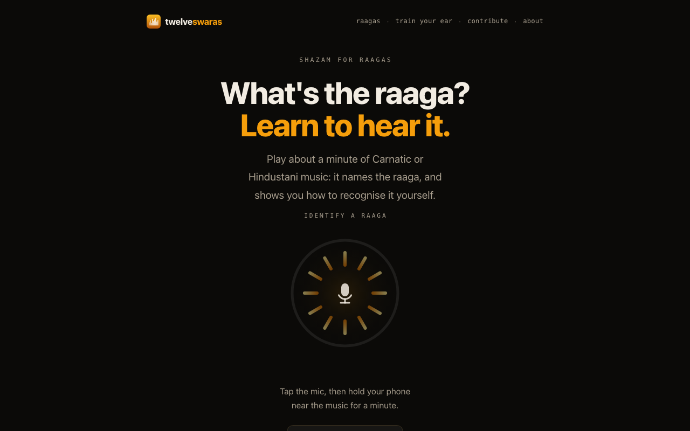
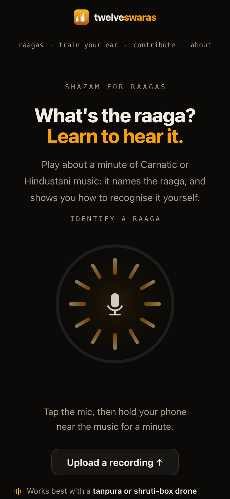
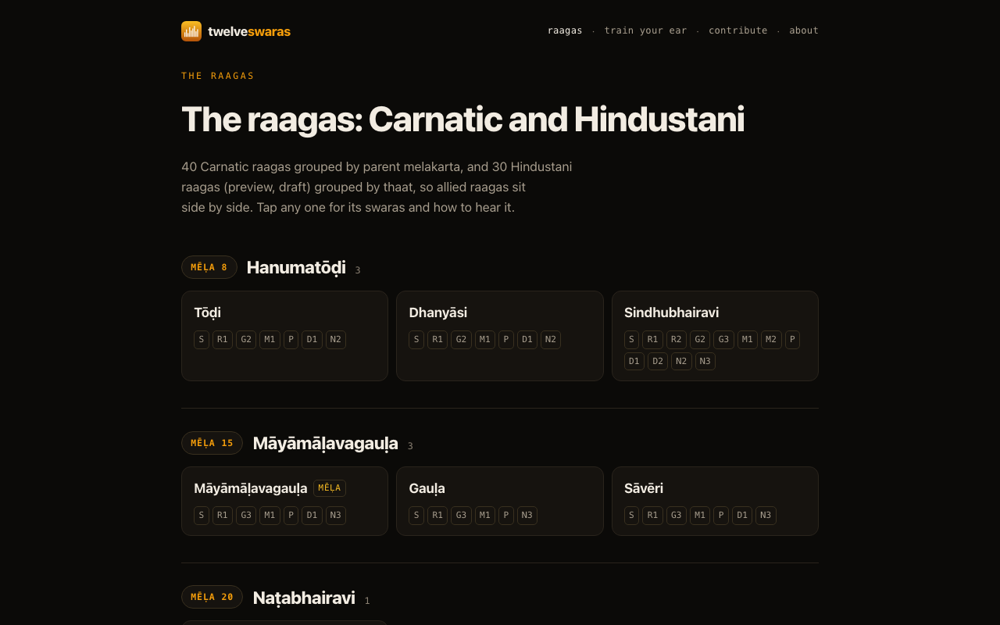
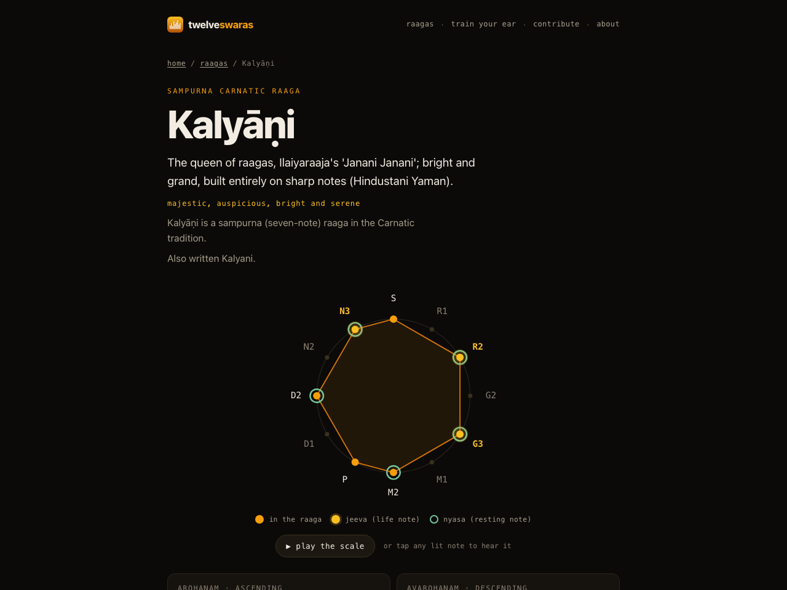

# twelveswaras

An open-source "Shazam for raagas": play it a clip of Carnatic or Hindustani music and it names the
raaga, shows the tonic (Sa) it heard, and helps you learn to hear that raaga yourself.

[](LICENSE)
[](#licensing)
[](#licensing)
[](https://twelveswaras.com)
[](https://github.com/twelveswaras/twelveswaras/actions/workflows/ci.yml)
[](https://registry.modelcontextprotocol.io/v0/servers?search=io.github.sathya-sankaran/twelveswaras)
[](https://doi.org/10.5281/zenodo.24096813)
[](cloudflare/DEPLOY.md)
<!-- GLAMA_BADGE -->

<p align="center">
  <a href="https://twelveswaras.com"></a>
</p>

**Live:** [twelveswaras.com](https://twelveswaras.com). The recognizer runs first-party on
Cloudflare (Worker + container), with no third-party embed.

> **Status:** live and recognizing **70 raagas** (40 Carnatic, 30 Hindustani) from one
> dual-tradition model. Hindustani is a preview: it has no real-world benchmark yet. The opt-in
> contribute-to-the-commons loop is live for both traditions. twelveswaras is non-commercial and
> open source, stewarded in the neutral [`twelveswaras`](https://github.com/twelveswaras) GitHub
> organisation, not owned by any company.

## Contents

- [What it does](#what-it-does)
- [Features](#features)
- [Use it from an AI assistant (MCP)](#use-it-from-an-ai-assistant-mcp)
- [Open data](#open-data)
- [How it works](#how-it-works)
- [Accuracy](#accuracy)
- [Project layout](#project-layout)
- [Development](#development)
- [Deploy](#deploy)
- [Contributing](#contributing)
- [Citing this work](#citing-this-work)
- [Licensing](#licensing)
- [Acknowledgements](#acknowledgements)

## What it does

Play about a minute of Carnatic or Hindustani music to [twelveswaras.com](https://twelveswaras.com),
from the microphone or an uploaded recording. It shows the top three raagas with calibrated
confidence and the tonic (Sa) it detected, and links to that raaga's page so you can learn to hear
it. Below a confidence threshold it says "not sure" and invites you to teach it the raaga instead.

<p align="center">
  
  &nbsp;&nbsp;
  
</p>

**Why "twelveswaras"?** The twelve swaras are the twelve note-positions of the octave, the shared
alphabet of both Carnatic and Hindustani music. The name, schema and pipeline are tradition-neutral
on purpose: Carnatic came first, but nothing locks the project to one tradition.

**How it differs from Shazam.** Shazam does audio *fingerprinting*: it matches a specific recording.
twelveswaras does audio *classification*: it infers the musical structure (the raaga) of any
performance, including one it has never heard. That is a Music Information Retrieval problem, not a
lookup.

## Features

- **Recognizer:** 70 raagas (40 Carnatic, 30 Hindustani) from one model, with the top three, the
  tonic, and an honest "not sure" below a confidence threshold. On a live listen it shows no raaga
  name for the first minute, because answers before then are right only about half the time.
- **Raaga Explorer** ([`/raaga/`](https://twelveswaras.com/raaga/)): a page per raaga, the 40
  Carnatic raagas grouped by parent melakarta and the 30 Hindustani raagas by thaat, so allied
  raagas sit side by side. Each page has a playable swara wheel, the scale, and how to hear it.
- **Train your ear** ([`/listen/`](https://twelveswaras.com/listen/)): an ear-training game for
  Carnatic raagas that runs in the browser: hear a scale, guess the raaga.
- **Contribute to the commons** ([`/contribute/`](https://twelveswaras.com/contribute/)): donate a
  clip after identifying it, or record one directly. Rights-gated, anonymous by default, and the
  audio stays private unless you release it under CC-BY-4.0.
- **MCP server** at `https://twelveswaras.com/mcp` for AI assistants.
- **Open data and model weights** under CC-BY-4.0.

<p align="center">
  
  &nbsp;
  
</p>

## Use it from an AI assistant (MCP)

twelveswaras is a remote MCP server at **`https://twelveswaras.com/mcp`** (Streamable HTTP, no
sign-in). Add it as a remote or custom connector in Claude, ChatGPT, Cursor or any MCP client. It is
published in the official
[MCP Registry](https://registry.modelcontextprotocol.io/v0/servers?search=io.github.sathya-sankaran/twelveswaras)
as `io.github.sathya-sankaran/twelveswaras` (the entry is [`server.json`](server.json)).

| Tool | What it does |
|------|--------------|
| `find_raaga` | Look a raaga up by any spelling (Mohanam, Mōhanaṁ, Bhoop, "kalyani ragam"). Returns its scale, parent, notes, key notes, songs, what it is confused with, and its page. |
| `raagas_with_notes` | The raagas that use a set of notes, in Carnatic labels (`S R2 G3 P D2`) or Hindustani letters (`S R G P D`). |
| `list_raagas` | The 70 raagas (40 Carnatic, 30 Hindustani), with their parent and page. |
| `identify_raaga` | The raaga in a recording at a public http(s) URL (mp3, wav, m4a, ogg, webm; up to 25 MB): the top three with confidence, the tonic, and each raaga's page. The recording is not stored. |

`find_raaga`, `raagas_with_notes` and `list_raagas` take an optional `tradition` (`carnatic` or
`hindustani`). To see the tool list from a shell:

```bash
curl -s https://twelveswaras.com/mcp \
  -H 'content-type: application/json' \
  -H 'accept: application/json, text/event-stream' \
  -d '{"jsonrpc":"2.0","id":1,"method":"tools/list"}'
```

The server is [`cloudflare/worker/src/mcp.js`](cloudflare/worker/src/mcp.js).

## Open data

Both files are CC-BY-4.0. Credit them as "twelveswaras (twelveswaras.com), CC-BY-4.0".

| URL | What it holds |
|-----|---------------|
| [`/data/raaga-reference.json`](https://twelveswaras.com/data/raaga-reference.json) | The facts on the raaga pages for all 70 raagas: scales, parents and note sets (positions count semitones from Sa, 0 to 11). |
| [`/data/raagas.json`](https://twelveswaras.com/data/raagas.json) | The 40 Carnatic raagas from the app's production guide, with the model's note sets. Records with `reviewed=false` are provisional. |

The scales, parents and note sets were checked against published sources; the corrections and their
sources are in [`raaga_corrections.json`](raaga_corrections.json). They have not been reviewed by a
musician, so corrections are welcome (see [Contributing](#contributing)).

## How it works

Fully automatic, with no input beyond the audio. [`METHODOLOGY.md`](METHODOLOGY.md) has the full
detail and citations.

1. **Predominant-melody pitch** from the audio (Essentia `PredominantPitchMelodia`).
2. **Tonic (Sa)** from the tanpura drone (Essentia `TonicIndianArtMusic`, the Salamon, Gulati and
   Serra multipitch method), from up to 300 s of audio: Sa accuracy keeps rising with listening
   time. Tonic-normalization, hearing everything relative to Sa, is the key step the Harvard
   reference thesis skipped.
3. **Feature:** a tonic-normalized, windowed **Time-Delayed Melody Surface (TDMS)**, a 2-D histogram
   of `(pitch(t), pitch(t+delay))` that captures **gamaka** (the movement between notes), not just
   which notes occur.
4. **Classifier:** XGBoost over the surfaces, window-aggregated.
5. **Swara chains:** a second-order Markov chain per raaga over the sung swaras captures the order
   of notes (phrases, zig-zag movement) that TDMS cannot see. Its evidence is fused with the
   classifier's, then **temperature-calibrated**, so a shown "70%" is right about 70% of the time.

The request path: the site (Cloudflare Pages) calls the Worker at `/api/*`, which calls the headless
recognizer (a Cloudflare Container running Essentia and XGBoost), with D1 for result metadata and R2
for opt-in clips.

## Accuracy

- **Studio benchmark** (frozen, 129 tracks): top-1 **0.830** (chance 0.025), after surface
  augmentation and a junk gate that drops non-melodic windows.
- **Real-world benchmark** (80 clips, the number that matters): top-1 **0.713**, top-3 **0.800**.
  Before the swara chains it was 0.537 / 0.762; before the tonic was heard up to 300 s, 0.688 /
  0.787.
- **Hindustani** (preview): the unified model cross-validates at about **0.88** top-1 on clean
  studio audio, with cross-tradition confusion of about 3%, and Carnatic held steady when Hindustani
  was added. That is the studio ceiling only; a real-world Hindustani benchmark is still pending.

The gap between studio and real-world audio is the whole problem, and closing it is what the data
commons is for. The full progression is in [`benchmark/leaderboard.md`](benchmark/leaderboard.md).

**Needs a drone.** Concert and TV audio works; solo voice with no drone is unreliable. Known
limitations are listed in [`METHODOLOGY.md`](METHODOLOGY.md#known-limitations).

## Project layout

| Path | What it is |
|------|------------|
| `raaga_id/` | The core library: pitch extraction, features (TDMS), model, training, calibration, evaluation. |
| `apps/` | Entry points: `identify` (local demo), `contribute`, `verify`, usage logging. |
| `space/` | Source of the recognizer API (`api.py`), bundled into the Cloudflare container by `cloudflare/recognizer/assemble.sh`. |
| `cloudflare/` | The Worker API and MCP server (`worker/`), the recognizer container (`recognizer/`), the D1 schema, and [`DEPLOY.md`](cloudflare/DEPLOY.md). |
| `site/` | The static website, including `site/data/` (the open data). |
| `tools/` | Training, cross-validation, real-world evaluation, page and data builders, clip fetchers. |
| `pipeline/` | Commons jobs: `pull_commons`, `import_shaale` (licensed bulk import), and the planned `retrain`. |
| `benchmark/` | The frozen evaluation set, the leaderboard and the real-world clips. |
| `tests/` | The Python test suite. |
| `e2e/` | Browser tests (Playwright) against the site, with the recognizer API stubbed. |
| `raagas*.json`, `raaga_guide*.json`, `raaga_profiles.json`, `raaga_corrections.json` | The raaga reference data the site and the open data are built from. |
| `server.json` | The MCP Registry entry. |

## Development

The project uses **two conda environments**, because the audio-to-pitch path (Essentia) needs
`numpy < 2` while training uses `numpy 2.x`.

```bash
# 1. Training, features, benchmark and the tests
conda env create -f environment.yml
conda activate twelveswaras

# 2. Inference and the local demo (the audio -> raaga path, with Essentia)
conda env create -f environment-inference.yml
conda activate twelveswaras-infer
python -m apps.identify
```

On Linux (for example the recognizer container), install from `requirements.txt` instead of
`environment.yml`.

### Tests

CI ([`.github/workflows/ci.yml`](.github/workflows/ci.yml)) runs all three suites on every pull
request and every push to `main`.

```bash
# Python suite, from the twelveswaras env at the repo root
pytest tests/ -q

# Worker and MCP unit tests (Node 20, no dependencies, no network)
cd cloudflare/worker && node --test

# Browser tests: the static site served from site/, the recognizer API stubbed
cd e2e
npm ci
npx playwright install chromium
npx playwright test
```

CI also fails on any em-dash (U+2014) in a tracked Markdown file, checks that `CITATION.cff` parses,
and checks the site's JSON-LD. The repo uses `ruff` for linting.

## Deploy

A merge to `main` deploys `site/` to Cloudflare Pages from CI, once the Python, lint and browser
checks pass. The Worker, D1, R2 and the recognizer container are deployed with Wrangler; the steps
are in [`cloudflare/DEPLOY.md`](cloudflare/DEPLOY.md).

## Contributing

For most people the most valuable contribution is not code: **contribute an audio clip** at
[twelveswaras.com](https://twelveswaras.com) after identifying a raaga, especially an in-the-wild
recording (a concert, radio, TV, your own practice with a drone). It grows the openly licensed data
commons and improves the model. Contributing is anonymous by default, with an optional public
credit in [`CONTRIBUTORS.md`](CONTRIBUTORS.md).

Musicians can review the raaga reference (open an issue or edit the JSON), and everyone can report
issues or send code. See [`CONTRIBUTING.md`](CONTRIBUTING.md), the
[`CODE_OF_CONDUCT.md`](CODE_OF_CONDUCT.md) and [`GOVERNANCE.md`](GOVERNANCE.md). Report security
issues privately as described in [`SECURITY.md`](SECURITY.md), not in a public issue.

The project follows [People's Digital Goods and Infrastructure (PDGI)](https://pdgi.org) principles:
people before digital, rights-centric, commons-oriented, transparent. [`PDGI.md`](PDGI.md) is a
public scorecard of how each one is implemented and where it still falls short.

**Roadmap.** Deepen the commons before widening it: more in-the-wild audio of the current 70 raagas
(about 12 varied recordings per raaga is the floor for learning one); new raagas are trained in only
once they reach that, always quarantined from the 70. Next, fold contributed clips into a retrain and
publish the CC-BY contributor dataset. Then quality: audio-based methods (pretrained music models)
once the dataset audio is available, allied-raaga disambiguation, an out-of-distribution detector for
confident-but-wrong cases, a real-world Hindustani benchmark, and an expert-annotation tier.

## Citing this work

If you use twelveswaras in research, please cite it. [`CITATION.cff`](CITATION.cff) holds the
machine-readable metadata (GitHub shows a "Cite this repository" button from it) and lists the
datasets and prior work the model builds on. Releases are archived on Zenodo:
[10.5281/zenodo.24096813](https://doi.org/10.5281/zenodo.24096813) always resolves to the latest
version, and each version has its own DOI on that page (1.0.0 is
[10.5281/zenodo.24096814](https://doi.org/10.5281/zenodo.24096814)). Please cite the version you used.

> Sankaran, S. (2026). *twelveswaras: an open-source raaga recognizer for Carnatic and Hindustani
> music* [Computer software]. Zenodo. https://doi.org/10.5281/zenodo.24096813

```bibtex
@software{sankaran_twelveswaras,
  author    = {Sankaran, Sathya},
  title     = {twelveswaras: an open-source raaga recognizer for Carnatic and Hindustani music},
  year      = {2026},
  publisher = {Zenodo},
  doi       = {10.5281/zenodo.24096813},
  url       = {https://doi.org/10.5281/zenodo.24096813}
}
```

For a specific version, add its version number and use that version's DOI from the Zenodo page.
Other styles (Harvard, MLA, Chicago and more) are on the Zenodo page and behind GitHub's "Cite this
repository" button.

## Licensing

- **Code:** MIT ([`LICENSE`](LICENSE)).
- **The running recognizer:** AGPL-3.0. It uses [Essentia](https://essentia.upf.edu) (AGPL-3.0) for
  pitch and tonic detection, so the recognizer service as a whole is covered by the AGPL: if you run
  a modified copy for others over a network, you must offer them its source. The MIT files in this
  repository stay MIT on their own.
- **Model weights:** CC-BY-4.0, downloadable (with SHA-256 checksums) from the
  [v1.0.0 release](https://github.com/twelveswaras/twelveswaras/releases/tag/v1.0.0). The model is
  trained on the Raga Recognition Dataset features (CC-BY-4.0); credit both those authors and
  twelveswaras (see [`CITATION.cff`](CITATION.cff)).
- **Reference data** (`/data/raaga-reference.json`, `/data/raagas.json`): CC-BY-4.0.
- **Reference swara profiles** (`raaga_profiles.json`, the learner panel): CC-BY-4.0, built from the
  same Raga Recognition Dataset features.
- **Contributor dataset (the commons):** CC-BY-4.0, kept separate from non-commercial source data
  (such as Saraga, CC-BY-NC-SA) so it stays cleanly reusable.

Code contributions are made under MIT and data contributions under CC-BY-4.0.

## Acknowledgements

Built on openly available research corpora, with attribution required by their licences:

- **Indian Art Music Raga Recognition Dataset** (CompMusic / MTG-UPF; Gulati et al.): the current
  model is trained on its pitch and tonic features, CC-BY-4.0
  ([Zenodo](https://doi.org/10.5281/zenodo.7278506)); the audio is separate and access-restricted.
  Its Carnatic (CMD) set backs the 40 Carnatic raagas and its Hindustani (HMD) set the 30
  Hindustani raagas.
- **Saraga Carnatic** (CompMusic / MTG-UPF): CC-BY-NC-SA. Its annotated tonics are the ground truth
  for the tonic benchmark (`tools/tonic_bench`); earlier seed models trained on it. Nothing derived
  from it is in the live model.
- **Community and partner contributions** (the data commons): opt-in recordings, CC-BY-4.0 when
  contributors release them publicly. Some are shared under a train-only licence (for example
  recordings from [Shaale](https://shaale.com)): they may be used to train and evaluate models, but
  the audio stays private and is never redistributed. They are not in the current model. Credited
  in [`CONTRIBUTORS.md`](CONTRIBUTORS.md).

Built with [Essentia](https://essentia.upf.edu) (AGPL), librosa and XGBoost. `gradio` is used only
by the local demo (`apps/identify`), not by the deployed recognizer.

Prior work it builds on:

- **S. Gulati et al.**, *Time-Delayed Melody Surfaces for Rāga Recognition* (ISMIR 2016): the TDMS
  feature at the heart of the model.
- **S. Gulati**, *Computational Approaches for Melodic Description in Indian Art Music Corpora*
  (PhD thesis, UPF 2016): the definitive reference, for the tonic and melody methods.
- **H. Narayanan**, *Classifying Ragams in Carnatic Music with Machine Learning* (Harvard, 2024), the
  "Shazam for ragas" reference implementation. twelveswaras improves on it with tonic-normalization
  and TDMS, and adopts its data-augmentation idea (see [`METHODOLOGY.md`](METHODOLOGY.md)).
- **Madhusudhan and Beigi**, *DEEPSRGM*: a sequence-model benchmark target.

The full bibliography is in [`METHODOLOGY.md`](METHODOLOGY.md#bibliography).
