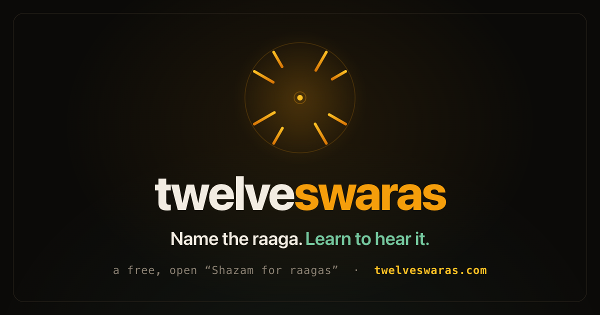
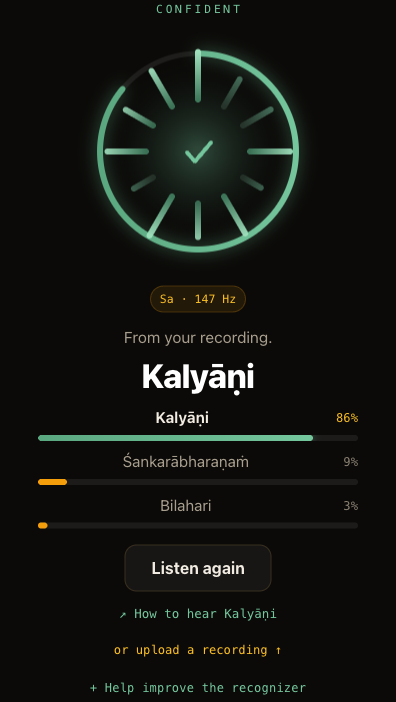

<p align="center"></p>

# twelveswaras

[](LICENSE)
[](https://twelveswaras.com)

An open-source "Shazam for raagas": play it a clip of Indian classical music (Carnatic, and now
Hindustani in preview) and it identifies the **raaga**, shows the top-3 with honest confidence
and the tonic (Sa) it found, and helps you learn to hear that raaga. Paired with a community-contributed, openly-licensed **data commons**
(now live) so the model improves over time.

**Live:** [twelveswaras.com](https://twelveswaras.com) · recognizer runs first-party on
Cloudflare (Worker + container); no third-party embed

> **Status:** live and recognizing **70 raagas** (40 Carnatic, 30 Hindustani) from one
> dual-tradition model. The Hindustani reference *pages* are still draft, pending a musician's
> review. The opt-in **contribute-to-the-commons** loop is live for both
> traditions (identify then donate, or contribute a recording directly).
> **Both traditions, one tool:** Carnatic and Hindustani share the twelve-swara space, so
> the name, schema, and pipeline are **tradition-neutral** by design (Carnatic came first).
> **Scope:** Non-commercial, open-source only. A public good stewarded in the neutral
> [`twelveswaras`](https://github.com/twelveswaras) GitHub organisation, not owned by any company.

<p align="center"></p>

## Why "twelveswaras"?

The twelve swaras are the twelve note-positions of the octave, the shared alphabet of **both**
Carnatic and Hindustani music. The name is tradition-neutral on purpose: Carnatic is where we
start, but nothing in the name, schema, or pipeline locks us to one tradition.

## Why this is different from Shazam

Shazam does audio *fingerprinting*: it matches a specific recording. twelveswaras does audio
*classification*: it infers the musical structure (the raaga) of **any** performance, including
one it has never heard. That's a Music Information Retrieval problem, not a lookup.

## How it works

Fully automatic, no user input beyond the audio (see [`METHODOLOGY.md`](METHODOLOGY.md) for the
full detail and citations):

1. **Predominant-melody pitch** from the audio (essentia `PredominantPitchMelodia`).
2. **Tonic (Sa)** from the tanpura drone (essentia `TonicIndianArtMusic`, the
   Salamon–Gulati–Serra multipitch method), from up to 300 s of audio: Sa accuracy keeps rising with
   listening time. *Tonic-normalization, heard relative to Sa, is the key unlock the Harvard
   reference thesis skipped.*
3. **Feature:** a tonic-normalized, windowed **Time-Delayed Melody Surface (TDMS)**, a 2-D
   histogram of `(pitch(t), pitch(t+delay))` that captures **gamaka** (the *movement* between
   notes), not just which notes occur.
4. **Classifier:** XGBoost over the surfaces, window-aggregated.
5. **Swara chains:** a second-order Markov chain per raaga over the sung swaras captures the
   *order* of notes (phrases, zig-zag movement) that TDMS cannot see; its evidence is fused with the
   classifier's, then **temperature-calibrated** (a shown "70%" is right about 70% of the time).

On a live listen the page shows no raaga name for the first minute: answers before then are right
only about half the time (see the listening-time curve in the leaderboard).

**Accuracy.** On the frozen 129-track studio benchmark: top-1 **0.830** (chance 0.025), after
surface augmentation and a junk gate that drops non-melodic windows. On the 80-clip **real-world**
benchmark, which is the number that actually matters: top-1 **0.713**, top-3 **0.800** (0.537 /
0.762 before the swara chains, 0.688 / 0.787 before the tonic heard up to 300 s). The gap
between those two is the whole problem, and closing it is what the data commons is for. Full progression in
[`benchmark/leaderboard.md`](benchmark/leaderboard.md). Needs a drone: concert/TV audio works;
solo voice with no drone is unreliable.

**Hindustani (30 raagas; reference pages still draft):** the unified dual-tradition model cross-validates at
~**0.88** top-1 on clean studio audio (Carnatic held steady, so adding Hindustani did not regress
it), with cross-tradition confusion only ~3%. That is the studio ceiling only: a **real-world
Hindustani benchmark is still pending**, and the Hindustani reference pages are draft awaiting
expert review, so treat this tradition as a preview.

## Data & attribution

Built on openly-available research corpora, **attribution required by their licenses**:

- **Indian Art Music Raga Recognition Dataset** (CompMusic / MTG-UPF; Gulati et al.): the current
  model is trained on its **pitch + tonic features**, **CC-BY-4.0**
  ([Zenodo](https://doi.org/10.5281/zenodo.7278506)); the audio is separate and access-restricted.
  Its **Carnatic (CMD)** set backs the 40 Carnatic raagas and its **Hindustani (HMD)** set the 30
  Hindustani raagas.
- **Saraga Carnatic** (CompMusic / MTG-UPF): CC-BY-**NC-SA**. Its annotated tonics are the
  ground truth for the tonic benchmark (`tools/tonic_bench`); earlier seed models trained on it.
- **Community and partner contributions** (the data commons): opt-in recordings, CC-BY-4.0 when
  contributors release them publicly. Some are shared under a **train-only** licence (for example
  recordings from **[Shaale](https://shaale.com)**): they may be used to train and evaluate models,
  but the audio stays private and is never redistributed. They are not in the current model.
  Credited in [`CONTRIBUTORS.md`](CONTRIBUTORS.md).

Built with **essentia** (**AGPL**; the deployed recognizer carries AGPL obligations, satisfied by
publishing all source), plus librosa and xgboost. `gradio` is used only by the local demo
(`apps/identify`), not by the deployed recognizer.

## Prior work we build on

- **S. Gulati et al.**, *Time-Delayed Melody Surfaces for Rāga Recognition* (ISMIR 2016): the
  TDMS feature at the heart of our model.
- **S. Gulati**, *Computational Approaches for Melodic Description in Indian Art Music Corpora*
  (PhD thesis, UPF 2016): the definitive reference; tonic + melody methods.
- **H. Narayanan**, *Classifying Ragams in Carnatic Music with Machine Learning* (Harvard, 2024),
  the "Shazam for ragas" reference implementation; we improve on it with tonic-normalization
  and TDMS, and adopt its data-augmentation idea (see METHODOLOGY.md).
- **Madhusudhan & Beigi**, *DEEPSRGM*: sequence-model benchmark target.

Full bibliography in [`METHODOLOGY.md`](METHODOLOGY.md).

## Roadmap

**Shipped:**

- **v0 to v0.5:** identify-only, then legible, calibrated recognition with gamaka features and a junk gate.
- **Raaga Explorer:** a browsable reference for all 40 Carnatic raagas grouped by melakarta (plus 30 Hindustani, pages still draft), an ear-trainer, and open data at `/data/raagas.json` (facts are draft, pending expert review).
- **v1 commons:** the opt-in contribute-to-the-commons loop, rights-gated and quarantined, audio private unless released CC-BY.
- **Abstention:** below a confidence threshold it says "not sure" and invites you to teach it the raaga.
- **Hindustani:** 30 raagas in the same model as the 40 Carnatic ones.
- **Swara chains:** the order of notes, fused with the classifier (real-world top-1 0.537 to 0.688).
- **Listening:** first-party recognizer with no cold start, the tonic heard up to 300 s, no names
  before a minute on a live listen, and plain reasons when the microphone fails.

**Next:**

- **Deepen the commons before widening it.** The highest-value contribution is more in-the-wild
  audio of the *current* 70 raagas (about 12 varied recordings per raaga is the floor for learning
  one); new raagas are trained in only once they reach that, always quarantined from the 70 (an
  unknown raaga can never be model-confirmed).
- **Verify and publish.** Community verification of pending clips, the consolidation job, and the
  public CC-BY contributor dataset.
- **Quality (v2).** Audio-based methods (pretrained music models) once the dataset audio is
  available, allied-raaga disambiguation, an out-of-distribution detector for the
  confident-but-wrong cases, a real-world Hindustani benchmark, and an expert-annotation tier.

## Getting started (developers)

The project uses **two conda environments** (the audio-to-pitch path needs `numpy < 2`,
training uses `numpy 2.x`, so they are kept separate):

```bash
# 1. Training + features + benchmark + most tests
conda env create -f environment.yml
conda activate twelveswaras

# 2. Inference + demo (essentia pitch + essentia tonic, the audio -> raaga path)
conda env create -f environment-inference.yml
conda activate twelveswaras-infer
python -m apps.identify
```

On Linux (for example the recognizer container) install from `requirements.txt` instead of
`environment.yml`. Run the tests from the `twelveswaras` env at the repo root:

```bash
pytest tests/
```

Top-level layout: `raaga_id/` (core library: pitch, TDMS features, model, training,
evaluation), `apps/` (local demo + contribute / verify entry points), `space/` (source of the
recognizer API, bundled into the Cloudflare container), `cloudflare/` (the Worker API, D1 schema,
recognizer container), `site/` (the website), `tools/` (training, benchmark and site-build scripts),
`pipeline/` (commons pull and import jobs), and `benchmark/` (the frozen evaluation set + leaderboard).

## Contributing

Contributions are very welcome. For most people the single most valuable one is not code:
**contribute an audio clip** at [twelveswaras.com](https://twelveswaras.com) after
identifying a raaga, which grows the openly-licensed data commons and improves the model.
Carnatic musicians can also review the raaga reference, and everyone can report issues or
send code.

See [`CONTRIBUTING.md`](CONTRIBUTING.md) for details and
[`CODE_OF_CONDUCT.md`](CODE_OF_CONDUCT.md) for community standards. Code contributions are
under MIT; data contributions under CC-BY-4.0. Security reports go to the private channel
in [`SECURITY.md`](SECURITY.md), not a public issue.

Contributing a clip is anonymous by default, with an optional public credit. People who
have grown the data commons are credited in [`CONTRIBUTORS.md`](CONTRIBUTORS.md).

## Citing this work

If you use twelveswaras in your research, please cite it. Machine-readable metadata is in
[`CITATION.cff`](CITATION.cff) (GitHub renders a "Cite this repository" button from it), which
also lists the datasets and prior work the model builds on. Releases are archived on Zenodo with a
DOI; please cite the version you used.

## Principles

twelveswaras is built on [People's Digital Goods and Infrastructure (PDGI)](https://pdgi.org)
principles: people before digital, rights-centric, commons-oriented, transparent. [`PDGI.md`](PDGI.md)
is a public, honest scorecard of how each one is implemented, and where we still fall short.

## Licensing

- **Code:** MIT.
- **Contributor dataset (the commons):** CC-BY-4.0, kept **separate** from non-commercial source
  data so it stays cleanly reusable.
- **Model:** the current model is trained on the Raga Recognition Dataset features (CC-BY-4.0,
  attribution required); earlier seed models trained on Saraga carried its CC-BY-NC-SA terms. Like
  the rest of the project, models are published for non-commercial use.

This is a non-commercial, open-source public good. See [`GOVERNANCE.md`](GOVERNANCE.md) for
stewardship and [`METHODOLOGY.md`](METHODOLOGY.md) for the full method + references.
